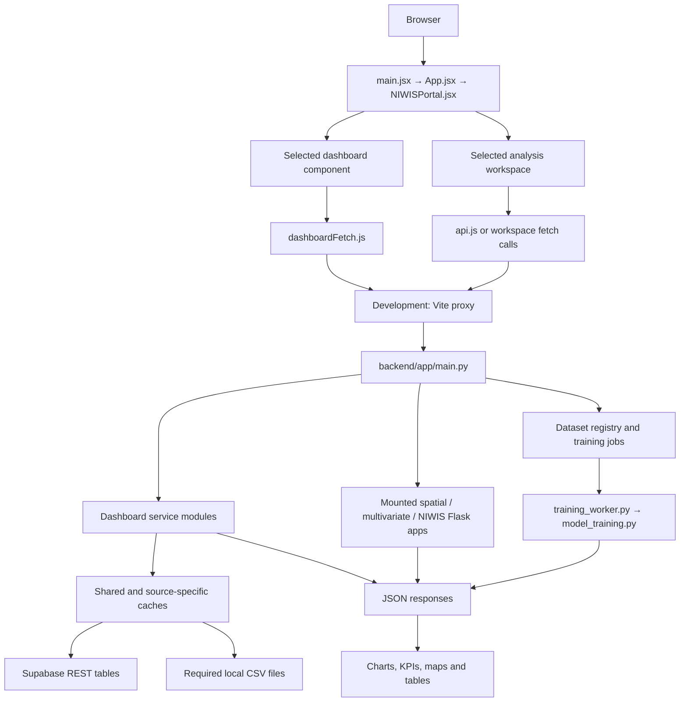
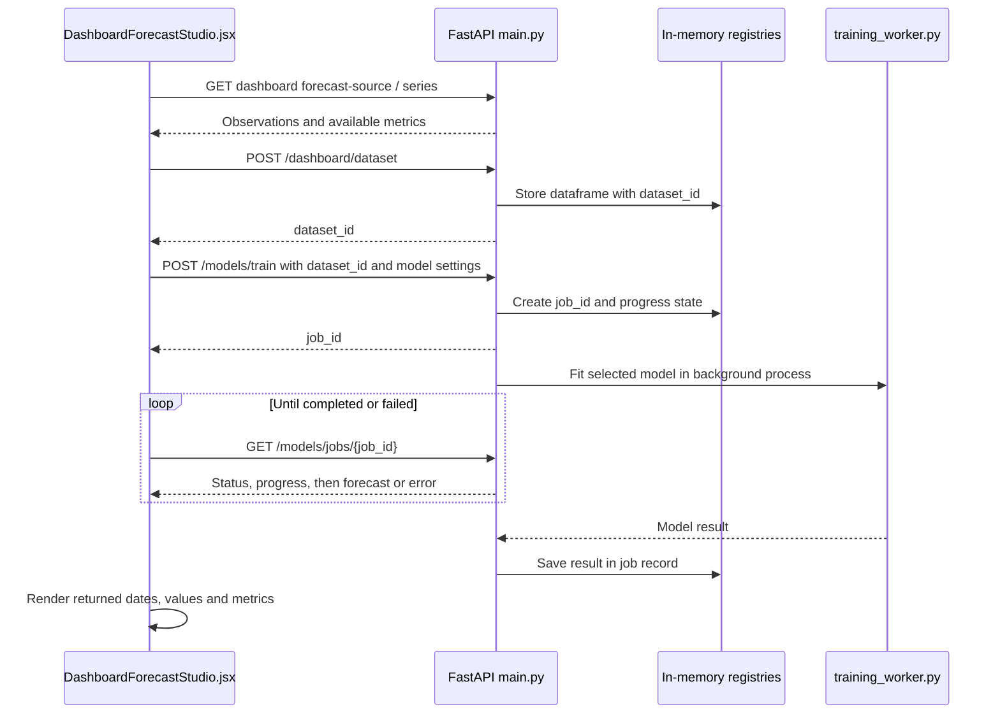

# NIWIS system flow

Audit date: 19 October 2026. This report traces the application before cleanup. The subsequent removal of unused files is recorded in [Cleanup-Report.md](Cleanup-Report.md); active application code and source datasets were preserved.

## 1. Overall connection

The application has one React frontend and one HTTP backend, FastAPI. Three Flask applications run inside FastAPI for spatial analysis, multivariate statistics, and provincial prediction summaries. Model training can start a separate background worker process.



## 2. Entry points and shared files

| File | Connection and purpose |
| --- | --- |
| [frontend/index.html](../../frontend/index.html) | Loads the React entry point. |
| [frontend/src/main.jsx](../../frontend/src/main.jsx) | Starts React and renders `App`. |
| [frontend/src/App.jsx](../../frontend/src/App.jsx) | Opens `NIWISPortal`. |
| [NIWISPortal.jsx](../../frontend/src/components/NIWISPortal.jsx) | Controls navigation, the role selection screen, dashboard selection and lazy component imports. |
| [demoData.js](../../frontend/src/niwis/demoData.js) | Supplies navigation, role definitions, reference catalogues and some static display values. It is actively imported despite its name. |
| [dashboardFetch.js](../../frontend/src/services/dashboardFetch.js) | Shares identical requests, handles cancellation, and briefly caches metadata and map assets in browser memory. |
| [api.js](../../frontend/src/services/api.js) | Connects dataset upload, analysis and model training to the backend through `/api`. |
| [DistrictMap.jsx](../../frontend/src/components/DistrictMap.jsx) | Connects district names and observations to the display boundary asset. |
| [LazyPlot.jsx](../../frontend/src/components/LazyPlot.jsx) and [DeferredPanel.jsx](../../frontend/src/components/DeferredPanel.jsx) | Load plotting and optional forecasting panels when needed. |
| [LoadingProgress.jsx](../../frontend/src/components/LoadingProgress.jsx) | Shared loading feedback; the displayed progress is estimated until the request completes. |
| [backend/app/main.py](../../backend/app/main.py) | Creates FastAPI, registers dashboard routers, mounts the Flask apps, and exposes dataset and training endpoints. |
| [dashboard_loader.py](../../backend/app/dashboard_loader.py) | Caches source results and shares a single in-flight load for identical keys. |
| [dashboard_response_cache.py](../../backend/app/dashboard_response_cache.py) | Adds response caching for selected dashboard requests. FastAPI also compresses larger responses. |
| [supabase_source.py](../../backend/app/supabase_source.py) | Reads server-side connection settings and supports Supabase reads and provincial history. |
| [database.py](../../backend/app/database.py) and [postgres_source.py](../../backend/app/postgres_source.py) | Provide an optional direct PostgreSQL path when explicitly enabled. |

The two unused frontend Supabase client files were outside the entry-point import graph and were removed during cleanup. The active dashboard flow sends requests to the backend.

## 3. Browser routes and API routes

Page paths such as `/climate`, `/vegetation`, `/reservoirs`, and `/groundwater` select React views. Their corresponding data requests use separate API paths.

[vite.config.js](../../frontend/vite.config.js) forwards requests during development:

| Browser request | Backend destination | Handling |
| --- | --- | --- |
| `/api/groundwater/dashboard` | `http://localhost:8000/groundwater/dashboard` | Removes the first `/api`. |
| `/api/models/train` | `http://localhost:8000/models/train` | Removes the first `/api`. |
| `/spatial-api/api/profile` | `http://localhost:8000/spatial-api/api/profile` | Preserves the path; FastAPI forwards it to the spatial Flask app. |
| `/multivariate-api/api/methods` | `http://localhost:8000/multivariate-api/api/methods` | Preserves the path; FastAPI forwards it to the multivariate Flask app. |
| `/niwis-api/api/predictions/latest` | `http://localhost:8000/niwis-api/api/predictions/latest` | Preserves the path; FastAPI forwards it to the NIWIS Flask app. |

The Vite proxy is part of the development server. A built frontend needs equivalent forwarding and a fallback to `index.html` for direct page navigation. [deployment/nginx.conf.example](../../deployment/nginx.conf.example) already describes these connections; deployment changes are outside this audit.

## 4. Dashboard-to-source connections

Frontend components below are in `frontend/src/components/`; backend services are in `backend/app/`.

| Dashboard component | Backend service / adapter | Current source flow |
| --- | --- | --- |
| `MeteorologicalDrought.jsx` | `meteorological_service.py` → `drought_source.py` | `meteorological_drought_master`; packaged meteorological CSV fallback. |
| `DroughtMonitoring.jsx` | `drought_monitoring.py` → `drought_source.py` | Combines the meteorological, hydrological and satellite drought tables; packaged fallbacks are available. |
| `SatelliteDrought.jsx` | Main satellite routes → `satellite_service.py` → `drought_source.py` | `satellite_remote_sensing`; packaged satellite CSV fallback. |
| `HydrologyDrought.jsx` | `hydrology_dashboard.py` / main hydrology routes → `hydrology_service.py` | `hydrological_drought_master` through the drought adapter; packaged hydrology CSV fallback. |
| `ClimateDashboard.jsx` | `climate_service.py` → `climate_source.py` | Six section 4 climate relations configured by `NIWIS_SUPABASE_TABLES_MODULE_2`. Local CSV mode requires explicit selection. |
| `VegetationCondition.jsx` | `vegetation_service.py` | Two section 5 vegetation and meteorological-driver relations, module 3. |
| `RainfallStatus.jsx` | `rainfall_service.py` | Section 6 core rainfall and derived-index relations, module 4. Additional runoff context is optional. |
| `RunoffStatus.jsx` | `runoff_service.py` | Reads the two local section 7 runoff CSVs. |
| `ReservoirStatus.jsx` | `reservoir_service.py` | Supabase `8_1_reservoir_operational_master`, configured by `NIWIS_SUPABASE_TABLES_MODULE_5`. This dashboard currently reads the database. |
| `SurfaceWaterNetwork.jsx` | `surface_water_service.py` | Three section 9 station, catchment and earth-observation relations; rainfall service supplies additional weather context. |
| `GroundwaterLevelMonitoring.jsx` | `groundwater_service.py` | Two section 10 borehole/aquifer and recharge-support relations, module 6. |
| `GroundwaterReserveAssessment.jsx` | `groundwater_reserve_service.py` | Three section 11 hydrogeology, recharge/discharge and sustainability relations; dedicated module 11 configuration is supported. |
| `WaterQualityMonitoring.jsx` | `water_quality_service.py` | Four section 12 physical, chemical, biological and SANSA relations; dedicated module 12 configuration is supported. |

For most monitoring pages, the component first requests metadata: available regions, dates, indicators, and source information. It then requests the selected chart period. Several dashboards request national map summaries separately from district chart data. Expanding a daily-detail panel or forecasting panel triggers additional requests.

The backend reads and normalizes source columns, calculates the requested summaries, preserves unavailable values, and returns JSON. The component turns that JSON into charts, map colours, cards, tables and exports. A CSV export button does not imply that the original source is a CSV.

## 5. Forecasting and analysis flow

### Dashboard forecast studio



The sequence uses backend paths; the browser adds `/api` through `api.js`. `model_training.py` implements model fitting. The worker defaults to one training process and supports configuration through `NIWIS_TRAINING_WORKERS`.

### Provincial summaries and provincial history are different paths

`NIWISPortal.jsx` requests `/niwis-api/api/predictions/latest` → `niwis_flask.py` → `supabase_source.load_latest_province_record()` → latest database observation per province → `compute_bundle()` → displayed risk summary. `compute_bundle()` calculates indicators and rules; it does not load one of the saved `.pkl` model files.

Provincial analysis and forecasting history use `/provinces/{province_id}/load` → `supabase_source.load_province_dataframe()`. In the default Supabase mode this function prefers `csv's/mateological.csv`, filters it to the selected province, and uses Supabase if that file is absent. Explicit PostgreSQL mode takes precedence over that CSV path. A failed or empty local CSV read raises an error rather than silently switching sources.

### Other analysis workspaces

| Workspace | Connection |
| --- | --- |
| Time series / model training | `api.js` → FastAPI dataset, analysis, feature-engineering, trend and forecasting endpoints. Uploaded CSV/Excel data is cleaned and registered in memory. |
| Spatial analysis | `SpatialAnalysis.jsx` → `/spatial-api/api/*` → `spatial_flask.py`. |
| Multivariate statistics | `MultivariateStatistics.tsx` → `/multivariate-api/api/*` → `multivariate_flask.py` → dataset engine and analysis registry. |

The multivariate registry loads analysis classes dynamically by module name. Those Python files are active even when no ordinary top-level import points to them. The generic API also has additional forecasting endpoints; the asynchronous job flow above describes the dashboard model-training path.

## 6. Files the current flow still needs

The six local CSVs below total approximately **144.8 MiB**. Removing them would change current behaviour or remove an available fallback.

| Relative path | Runtime use |
| --- | --- |
| `csv's/mateological.csv` | Preferred provincial forecasting/analysis history in default mode. |
| `csv's/hydrology.csv` | Hydrological drought fallback. |
| `csv's/satelite.csv` | Satellite drought fallback. |
| `vegetation/5.2_meteorological_drivers_saws_master.csv` | Meteorological drought fallback. |
| `Runoff Status Monitoring/7.1_runoff_variables_master.csv` | Runoff daily observations. |
| `Runoff Status Monitoring/7.2_derived_runoff_indicators_master.csv` | Runoff derived indicators. |

The frontend graph references `Water-and-Sanitation.png`, `multivariate.css`, and `south_africa_adm2.display.geojson` in `frontend/public/`. The larger original `south_africa_adm2.geojson` is an input to [build_dashboard_map.py](../../scripts/build_dashboard_map.py), which generates the display map. It has a build-time purpose even though the dashboards request the smaller file.

Additional climate CSV files remain inputs to the explicitly selectable CSV adapter. Other datasets may support tests, reports, comparison scripts, or research notebooks even when they are outside the active runtime path. A filename containing `demo`, a CSV directory, a Flask app, or an older dataset is not sufficient evidence for deletion.

## 7. Import graph and review candidates

[file-connections.json](file-connections.json) records the detailed import edges, public assets, and required CSVs. [scripts/audit_application.py](../../scripts/audit_application.py) regenerates it without importing the application or reading credential values.

The static audit follows **63 frontend source/style files** from `main.jsx` and **55 backend Python files** from `app/main.py`, including the dynamic multivariate registry. It found no unresolved relative frontend imports and no Python files under `backend/app` outside the traced graph. Reachability shows a connection; it does not prove every branch is used in every session.

These 10 frontend files were outside the entry-point graph and were removed after the reference review:

```text
frontend/src/components/AnalysisChart.jsx
frontend/src/components/DataUpload.jsx
frontend/src/components/FeatureEngineering.jsx
frontend/src/components/ModelGuide.jsx
frontend/src/components/NIWISDashboard.jsx
frontend/src/components/ProvinceForecasting.jsx
frontend/src/components/SouthAfricaMap.jsx
frontend/src/lib/supabaseClient.js
frontend/src/niwis/mateoData.js
frontend/src/services/supabaseClient.js
```

An unused `DataUpload.jsx` does not mean the upload feature is unused: active workspaces have their own upload flow. Packages without direct imports also need a dependency review before removal; for example, `plotly.js` is required by the plotting wrapper's peer dependency.

## 8. Flow findings that matter for the next stage

- **The analysis services belong to the same HTTP backend.** Starting or preserving separate Flask servers is unnecessary for the mounted routes.
- **Uploaded datasets, analysis state, caches and training-job records live in process memory.** Restarting the backend loses that state. Multiple independent API processes would not share those dictionaries.
- **Some portal content is static.** Alerts, the pipeline's reported health, source-status catalogue entries, and some fallback/projection values are defined in frontend code. They are not evidence of a live ingestion or alerting service.
- **The role selection screen only opens the portal.** Its buttons set React state; it is a prototype entry flow rather than an authenticated account or permission check.
- **Configuration and start scripts have distinct roles.** `backend/start.ps1` selects the backend virtual environment and starts Uvicorn; Vite starts the frontend separately. The active source configuration comes from runtime environment values. Example environment files alone do not establish which adapter is active.

## 9. Verification and limits

The import audit is static source inspection, including lazy frontend imports and the known dynamic Python registry. Read-only checks of the running backend are recorded in [live-api-summary.json](live-api-summary.json):

- All 14 checked GET endpoints returned HTTP 200: FastAPI health, three mounted Flask health routes, OpenAPI, and nine dashboard metadata routes.
- FastAPI's OpenAPI document lists 75 paths. The mounted Flask routes have their own routing and are not included in that count.
- Climate, vegetation, rainfall, reservoirs, groundwater, surface water, groundwater reserve and water quality metadata reported Supabase as their source. Runoff's CSV source was verified in code.
- The nine checked metadata responses listed 52 district entries each, except reservoirs, which listed 53 reservoir groups.
- Metadata requests took approximately 5.6–35 seconds in this run with three concurrent checks. Cache state and upstream conditions were not controlled, so these are observations rather than a comparative performance benchmark.

These checks do not upload data, start model training, or prove that every chart and model works end to end.

The initial audit changed no application files. The subsequent cleanup is recorded in [Cleanup-Report.md](Cleanup-Report.md). No deployment was performed.
