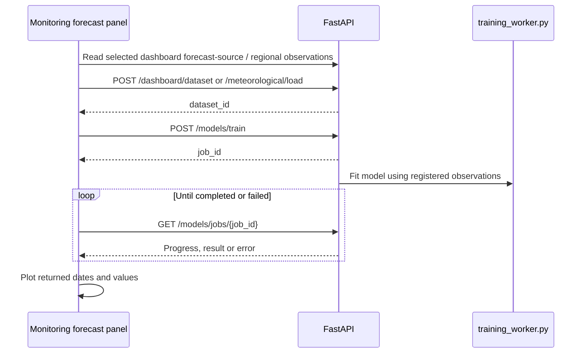

# NIWIS system flow

Updated 20 October 2026 after removing Analysis Studio and Prediction Engine
and completing the database-only drought source migration.
The [removal report](Dashboard-Removal.md) records the deleted files and verification.
The [earlier cleanup](Cleanup-Report.md) remains a historical record.

## Application entry points

```mermaid
flowchart LR
    Browser --> Vite[React / Vite]
    Vite --> Portal[main.jsx ? App.jsx ? NIWISPortal.jsx]
    Portal --> Modules[Lazy monitoring components]
    Modules --> Proxy[/api proxy/]
    Proxy --> API[FastAPI app.main:app]
    API --> Services[Monitoring service routers]
    Services --> Sources[Supabase / configured PostgreSQL adapter]
    Portal --> Summary[/niwis-api: shared provincial summary]
    Summary --> Database[Latest provincial database observations]
```

`frontend/src/niwis/demoData.js` defines navigation. `NIWISPortal.jsx` maps URLs
and renders monitoring modules. Unknown paths, including the former standalone
pages, open `/drought`. `App.jsx` renders the portal directly.

Vite proxies `/api` to FastAPI and strips that prefix. `/niwis-api` keeps its
prefix and reaches the remaining mounted Flask provincial summary service.
The spatial and multivariate applications and their proxies have been removed.

## Monitoring modules and sources

| Dashboard | Backend | Current source |
| --- | --- | --- |
| Drought Monitoring | `drought_monitoring.py` / `drought_source.py` | Three drought database tables; no CSV fallback. |
| Meteorological Drought | `meteorological_service.py` | Supabase observations. |
| Hydrological Drought | `hydrology_dashboard.py` / `hydrology_service.py` | `hydrological_drought_master`; no CSV fallback. |
| Satellite & Remote Sensing Drought | `satellite_service.py` | `satellite_remote_sensing`; no CSV fallback. |
| Climate and its six indicator sections | `climate_service.py` / `climate_source.py` | Supabase in the current configuration. An explicitly selected CSV adapter remains available. |
| Vegetation Condition Monitoring | `vegetation_service.py` | Supabase vegetation and meteorological relations. |
| Rainfall Status Monitoring | `rainfall_service.py` | Supabase rainfall, satellite and index relations. |
| Runoff Status Monitoring | `runoff_service.py` | `runoff_variables_master` and `7.2_derived_runoff_indicators_master`. |
| Surface Water Monitoring Network | `surface_water_service.py` | Section 9 hydrology, dated catchment characteristics and earth observation relations. |
| Dam and Reservoir Status | `reservoir_service.py` | `8_1_reservoir_operational_master`. |
| Groundwater Level Monitoring Network | `groundwater_service.py` | Section 10 database relations. |
| Groundwater Reserve Assessment | `groundwater_reserve_service.py` | Section 11 database relations. |
| Water Quality Monitoring Network | `water_quality_service.py` | Four section 12 database relations. |

Metadata supplies regions, available dates, indicators and source details. The
selected period then supplies chart series, summaries and a complete national map.
Daily details and forecasts request additional bounded series when opened. CSV
export buttons create downloads from API results; they do not imply a CSV input.

## Forecasts retained inside monitoring dashboards

`DashboardForecastStudio.jsx` and the regional `OverviewForecastStudio` remain
shared monitoring features. Their model engine and dependencies are retained.



Regional history charts retain `/provinces/series/{dataset_id}`; despite its older
name, this reads already registered regional observations, not a provincial CSV.
`model_training.py` and `forecasting/` are still used by these forecast panels.

The separate `/drought-status` route still uses `/niwis-api/api/predictions/latest`
for shared provincial summaries. `niwis_flask.py` calculates these from the latest
database observations. Its continued presence does not restore the removed
Prediction Engine page. The old CSV-first provincial history loader and its
`/provinces/{province_id}/load` endpoint have been removed.

## Local runtime data

The current database configuration requires **zero runtime CSV files**.
The three drought dashboards read their database tables directly. Their CSV
fallback reader and the `NIWIS_DROUGHT_LOCAL_FALLBACK` setting have been removed;
outages remain explicit and empty database selections remain empty.

`NIWIS_CLIMATE_SOURCE=csv` explicitly activates the separate climate CSV
adapter; the runtime configuration currently selects `supabase`.

Other original datasets, provincial files and notebooks remain as research,
comparison and test inputs. They are not standalone page application code.

## Source and dependency audit

Run `backend/.venv/Scripts/python.exe scripts/audit_application.py` from the
project root. [file-connections.json](file-connections.json) records the reachable
source files, imports, public assets and optional runtime data. The current
entry graph contains **47 frontend files** and **38 backend files**, with no
unresolved frontend imports or application source files outside the graph.

`plotly.js` is loaded through `react-plotly.js` and remains required. Highcharts
and the retired analysis-only Python requirements have been removed.

## Runtime and deployment

`backend/start.ps1` starts the backend with its dedicated environment. Vite runs
separately during development. Deployment needs the built frontend, the backend
and its environment settings, plus the required map/logo assets.
Supabase keys remain server side. Original datasets can be
excluded from a deployment package when no selected adapter or deployed test
uses them.

Dataset and training-job registries are process-local. A production setup must
account for this before adding multiple backend workers. No deployment was
performed during this cleanup.
