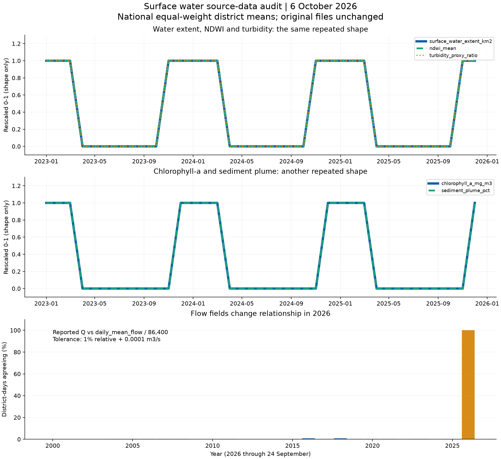

# Surface Water Monitoring Network — data inspection report

**Prepared:** 6 October 2026  
**Scope:** All rows in the three supplied section 9 CSV files, plus the surface-water dashboard's field mappings and aggregation code. This report does not audit the other NIWIS modules or verify the files against external DWS/SANSA records.

## Main conclusion

**The similar graphs are substantially explained by repeated and mathematically related values in the source files.** The satellite file is especially repetitive: each of its six indicators has only **two distinct values per district across 321 months**. Five indicators repeat the same calendar-month values every year. Some indicator pairs have exactly the same shape after rescaling, both nationally and within every district.

The inspected chart controls select distinct fields, and the backend maps them to distinct CSV columns. There is no apparent shared-field wiring error in these controls. Some views deliberately show the same variable at different time resolutions; these are complementary views, not independent indicators.

The evidence is consistent with templates, derived series or backfilled values. **The files alone cannot establish whether these were intentionally generated, imputed or incorrectly assembled.** They should not be presented as independently verified telemetry or satellite observations without their production metadata.

## 1. Inventory and structural checks

| Dataset | Rows | Spatial coverage | Temporal coverage |
|---|---:|---|---|
| 9.1 Hydrological variables | 507,728 | 52 districts | 9,764 daily dates, 1 Jan 2000–24 Sep 2026 |
| 9.2 Catchment characteristics | 52 | 52 districts | Static; no observation date |
| 9.3 Earth observation | 16,692 | 52 districts | 321 monthly dates, Jan 2000–Sep 2026 |

All three files have zero missing cells, zero duplicate rows and zero duplicate district/date keys (district-only keys for the static file). Date, year and month columns are consistent. These checks establish structural completeness, not scientific accuracy.

Hydrology has a row for each district on every observed date. September 2026 has only 24 daily observations per district; August 2026 is the last complete hydrological month. Satellite rows dated 1 September identify a monthly record, but the file does not say whether it is a complete composite or how it was produced.

There are no gauge IDs, station coordinates, 15-minute timestamps, sensor quality flags or satellite acquisition identifiers. These files represent district-level records, not a documented 3,500-station network. Baseflow index is absent.

## 2. Why satellite graphs look identical — high-priority finding

For every district, the following five indicators have the exact same value for a given calendar month throughout the available years:

- Surface water extent
- NDWI
- Turbidity proxy
- Chlorophyll-a
- Sediment plume percentage

Each test covers **624 district/calendar-month groups (52 × 12)**. All 624 groups repeat exactly for each of those five indicators. Flood extent repeats across years in 416 of 624 groups, and still has only two distinct values per district over the full record.

| Indicator comparison | Pearson correlation across 321 months | Meaning |
|---|---:|---|
| Water extent vs NDWI | +1.000000 | Identical rescaled temporal shape |
| Water extent vs turbidity | +1.000000 | Identical rescaled temporal shape |
| Chlorophyll-a vs sediment plume | +1.000000 | Identical rescaled temporal shape |

These relationships hold for the national equal-weight district averages **and within all 52 districts**, to floating-point precision. This is not merely a similar regional climate signal: the supplied series are exact two-level patterns. Correlation here does not establish a physical causal relationship or independent confirmation.

For all districts, NDWI falls by exactly 0.23 and turbidity by exactly 0.30 in April–October relative to January. Chlorophyll-a falls by exactly 6.3 mg/m³ and sediment plume by exactly 11.7 percentage points in April–November. The uniform timing and increments need an explanation from the data producer.

**Concrete example: City of Cape Town**

| Month | Water extent (km²) | NDWI | Turbidity ratio | Chlorophyll-a (mg/m³) | Sediment plume (%) |
|---|---:|---:|---:|---:|---:|
| Jan 2000 | 51.17 | 0.33 | 0.95 | 19.8 | 18.5 |
| Jan 2025 | 51.17 | 0.33 | 0.95 | 19.8 | 18.5 |
| Jan 2026 | 51.17 | 0.33 | 0.95 | 19.8 | 18.5 |
| Jul 2000 | 39.16 | 0.10 | 0.65 | 13.5 | 6.8 |
| Jul 2025 | 39.16 | 0.10 | 0.65 | 13.5 | 6.8 |
| Jul 2026 | 39.16 | 0.10 | 0.65 | 13.5 | 6.8 |

Identical complete series also occur across different districts:

| Indicator | Districts sharing a complete series with another district | Example |
|---|---:|---|
| Water extent | 33 of 52 | Alfred Nzo, Fezile Dabi and Lejweleputswa |
| NDWI | 43 of 52 | Alfred Nzo and Eden |
| Turbidity | 36 of 52 | Alfred Nzo and Ekurhuleni |
| Chlorophyll-a | 38 of 52 | Alfred Nzo and Frances Baard |
| Sediment plume | 46 of 52 | Alfred Nzo, Capricorn and City of Tshwane |
| Flood extent | 48 of 52 | Cacadu, Siyanda and West Coast, among others |

**Consequence:** Five satellite indicators contain no year-to-year change at matching months. Using them to infer long-term improvement, deterioration or forecasting skill would be misleading. A model could reproduce the template accurately without predicting real observations.

## 3. Daily rows often contain monthly or annual values

| Hydrological field | Observed effective cadence |
|---|---|
| Daily flow volume and daily sediment load | Vary within every district-month |
| Reported river discharge | Constant within 16,224 of 16,692 district-months; all 2000–2025 months |
| Flow velocity | Constant within every district-month |
| Stage height | Constant within every district-month |
| Suspended sediment concentration | Constant within every district-month |
| Reported monthly sediment-rate field | Constant within all 2000–2025 district-months; varies during 2026 |
| Reported peak instantaneous flow | Constant within all 1,404 district-years |
| Rating a, b and R² | Constant throughout the record within each district |

**Consequence:** Flat daily stage and velocity charts faithfully reproduce the file. Repeating a monthly value on every daily row does not create daily measurements. Annual peak values cannot establish event timing, flood duration or daily peak behaviour. The reported discharge also changes its apparent cadence in 2026.

## 4. Flow fields are inconsistent, with a clear 2026 break — high priority

Using the supplied interpretation that `daily_mean_flow` is a volume in m³/day, the corresponding mean discharge is:

`volume-equivalent Q = daily_mean_flow / 86,400`

Agreement was tested with a tolerance of 1% relative plus 0.0001 m³/s.

| Period | Rows checked | Rows agreeing | Agreement |
|---|---:|---:|---:|
| 2000–2025 | 493,844 | 1,269 | **0.257%** |
| 2026 through 24 Sep | 13,884 | 13,884 | **100%** |
| Full record | 507,728 | 15,153 | 2.984% |

The difference in 2026 is at most 0.00005 m³/s, consistent with four-decimal rounding. Before 2026, the fields are overwhelmingly not equivalent. This is evidence of a changed calculation, units, cadence or source definition, not enough evidence to decide which field is correct.

The reported monthly volume also disagrees with summed daily volume in **all 16,640 complete district-months**, at a 1% relative tolerance plus 0.0001 m³ absolute tolerance. The median ratio of reported monthly volume to summed daily volume is **0.01661**, approximately 1/60.2. Ratios range from 0.00522 to 0.02962, so one universal scaling factor would not fix the discrepancy.

September 2026 contains **24 different reported monthly-volume values per district** rather than one monthly value. All 52 districts are affected. The dashboard currently suppresses those conflicting monthly source values and retains observed daily-derived totals separately.

**Consequence:** Trends spanning 2025–2026 and long-term flow comparisons need qualification. Confirm units, aggregation definitions and the 2026 processing change before selecting a canonical discharge/volume series. Do not silently rescale or replace historical records.

## 5. Sediment curves are calculated from flow and concentration

Two identities hold across every one of the 507,728 rows to the source's four-decimal rounding precision:

`daily_sediment_load_t_day = daily_mean_flow × suspended_sediment_concentration / 1,000,000`

`monthly_sediment_load_t_day = river_discharge_q × suspended_sediment_concentration × 0.0864`

Both maximum absolute residuals are approximately 0.00005 t/day. These are dimensionally consistent conversions under the supplied units. Similar flow/load shapes are therefore expected: sediment load is numerically derived from flow and concentration, rather than an independent series.

The two sediment fields inherit the disagreement between the two flow fields. Despite its name, `monthly_sediment_load_t_day` has rate units and varies daily during 2026; it should not be interpreted as a monthly total.

## 6. Catchment characteristics contain duplicated and constant attributes

- **Grassland and cropland percentages are exactly equal in all 52 districts.** This may reflect duplication during preparation; the file cannot establish which column is correct.
- The eight reported land-cover percentages total **100.17%–135.81%**, averaging **113.94%**. All 52 districts fail a 100% partition check with a 0.1 percentage-point tolerance. Clarify whether the classes overlap or were incorrectly assembled; do not assume mutually exclusive areas.
- Mean slope is **4.5°**, topographic wetness index **7.85**, and vegetation cover **65.4%** in every district. These fields cannot explain spatial differences in their supplied form.
- The soil fractions contain only **three distinct percentage combinations** across 52 districts. They sum to 100%, but may be class-based assignments rather than measured within-district fractions.

**Consequence:** Similar soil panels and identical terrain cards are source-driven. Land cover should remain independent bars until the class definitions are resolved; a 100% composition chart would imply unsupported precision.

## 7. Rating parameters need source validation

**42 of 52 districts have a supplied R² of zero.** The coefficient `a` ranges up to approximately 8.47 × 10²¹ and exponent `b` up to 18.7883. Large coefficients alone do not prove an error, but interpretation requires the exact equation, datum offset, units, fitting period and calibration observations.

The dashboard plots observed stage/Q pairs and reports the supplied coefficients. It does not invent a predictive rating curve. Repeated monthly stage values also limit what a daily scatter plot can show.

## 8. Recommended actions

1. **Resolve the source definitions first.** Obtain the data dictionary and preparation scripts, particularly the historical/2026 flow conversion and the satellite generation or gap-filling method. Ask which values are observed, modelled, imputed or illustrative.
2. **Label repeated satellite series explicitly.** Until provenance is resolved, present them as supplied repeating patterns, not independently validated monthly observations. Avoid treating correlated templates as multiple confirmations of a water-status finding.
3. **Use effective cadence in the interface.** Show stage, velocity and concentration at monthly cadence; show source peaks as annual values. Keep truly varying daily volume/load detail, with the unresolved unit discrepancy visible.
4. **Flag the 2026 flow change on trend charts.** Do not train forecasts or calculate long-term anomalies across that break without resolving the definitions. Exclude unverified repeating satellite templates from operational forecasting inputs.
5. **Resolve land-cover duplication and overlaps.** Retain original values and record corrections separately once the producer confirms the intended classes. Obtain district-specific terrain attributes where available.
6. **Preserve honest aggregation.** National values currently mean an equal-weight average of districts, not national discharge or a total across independent catchments. Any basin/network total requires non-overlapping catchments and station topology.

Changing chart colours or drawing different curves would not resolve these data limitations. These recommendations are proposed follow-up changes; this inspection leaves source files and dashboard behaviour unchanged.

## 9. Evidence and reproducibility



The first two panels rescale each series to 0–1 to compare shapes; they do not imply equal original units or magnitudes. The third panel shows the fraction of district-days satisfying the discharge/volume consistency check, including partial-year 2026.

- [Printable evidence figure](data-quality-evidence.pdf)
- [Machine-readable audit results and source SHA-256 hashes](audit-summary.json)
- [Column ranges, unique values and missing-value counts](column-profile.csv)
- [Monthly volume checks for all district-months](monthly-volume-checks.csv)
- [Catchment values and land-cover totals](catchment-checks.csv)
- [Exact repeated satellite examples](repeated-satellite-examples.csv)
- [High-correlation pairs and linear-fit residuals](high-correlations.csv)

Four additional correlation matrices are included for raw hydrology, raw satellite data, district-month values and national-month means. Correlations do not establish causation; derived daily-to-monthly quantities are expected to correlate strongly. Pairwise correlation checks omit constant variables.

Reproduce from the project root with:

```powershell
.venv/Scripts/python.exe scripts/audit_surface_water.py
```

The script reads all source rows, writes audit tables and figures to this report folder, and does not modify the source files. The narrative report records the interpretation of this audited snapshot; rerunning the script updates evidence files, not this narrative automatically.
